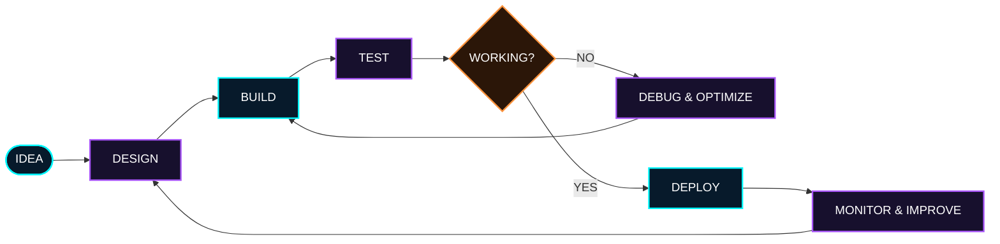

<!-- ===================== HERO ===================== -->
<p align="center">
  
</p>

<p align="center">
  
</p>

<p align="center">
  <a href="https://github.com/PRINCE-TIWARI07"></a>
  <a href="https://www.linkedin.com/in/prince-tiwari-3b75ab26b/"></a>
  <a href="https://x.com/PrinceTiwa58080"></a>
</p>

<p align="center"><b>⚡ Turning ideas into real-world products.</b></p>

---

## `01 // ABOUT ME`

```js
const prince = {
  name: "Prince Tiwari",
  role: "Full-Stack Developer",
  education: "B.Tech IT",
  cgpa: 8,
  focus: [
    "Web Development",
    "Backend Engineering",
    "AI / ML",
    "Real-Time Applications",
    "System Design"
  ],
  currentlyLearning: [
    "Advanced Backend Development",
    "System Design (LLD & HLD)",
    "AI Engineering",
    "Data Structures & Algorithms"
  ],
  philosophy: "Build → Break → Debug → Learn → Build Better 🚀"
};
```

- 🔭 Building full-stack and AI-powered applications.
- ⚙️ Interested in scalable APIs, databases, and real-time systems.
- 🧠 Improving backend architecture, DSA, and system design.
- 🤝 Open to interesting software collaborations.

## `02 // TECH ARSENAL`

<p align="center"><b>LANGUAGES</b></p>
<p align="center">
  
</p>

<p align="center"><b>FRONTEND</b></p>
<p align="center">
  
</p>

<p align="center"><b>BACKEND & REAL-TIME</b></p>
<p align="center">
  
  <br />
  
  
</p>

<p align="center"><b>DATABASES & DATA TOOLS</b></p>
<p align="center">
  
</p>

<p align="center"><b>AI / ML & DEVELOPER TOOLS</b></p>
<p align="center">
  
</p>
## `03 // FEATURED PROJECTS`

<table>
  <tr>
    <td width="50%" valign="top">
      <h3>🧠 LLM RAG Assistant</h3>
      <p>PDF-powered AI assistant that retrieves relevant document context through semantic search and generates grounded answers.</p>
      <p><code>Node.js</code> <code>Express</code> <code>LangChain</code> <code>Gemini</code> <code>Qdrant</code> <code>Groq</code></p>
      <a href="https://github.com/PRINCE-TIWARI07/rag-document-assistant">↗ View Repository</a>
    </td>
    <td width="50%" valign="top">
      <h3>🤖 Tender Sahayak</h3>
      <p>AI-powered tender analysis system designed to help users understand tender documents and eligibility requirements.</p>
      <p><code>React</code> <code>FastAPI</code> <code>PostgreSQL</code> <code>AI</code></p>
      <a href="https://github.com/PRINCE-TIWARI07/Tender-Sahayak">↗ View Repository</a>
    </td>
  </tr>
  <tr>
    <td width="50%" valign="top">
      <h3>💳 Paytm-Style Backend</h3>
      <p>Backend application implementing user authentication, account management, and transactional money transfers.</p>
      <p><code>Node.js</code> <code>Express</code> <code>MongoDB</code> <code>JWT</code> <code>Mongoose</code></p>
      <a href="https://github.com/PRINCE-TIWARI07?tab=repositories">↗ Find Repository</a>
    </td>
    <td width="50%" valign="top">
      <h3>🌾 FarmSetu</h3>
      <p>Agritech-focused application exploring digital tools and workflows for agricultural use cases.</p>
      <p><code>JavaScript</code> <code>PWA</code> <code>Agritech</code></p>
      <a href="https://github.com/PRINCE-TIWARI07/FarmSetu">↗ View Repository</a>
    </td>
  </tr>
</table>

### More Repositories

- 🎨 [Portfolio](https://github.com/PRINCE-TIWARI07/Portfolio-Prince_Tiwari)
- 🔳 [QRTransfer](https://github.com/PRINCE-TIWARI07/QrTransfer)
- 🎟️ [E-Ticket Booking](https://github.com/PRINCE-TIWARI07/E-ticket-booking-)
- 📂 [All Repositories](https://github.com/PRINCE-TIWARI07?tab=repositories)
## `04 // ENGINEERING WORKFLOW`



## `05 // CURRENT MISSION`

| Track | Current focus |
|---|---|
| Backend engineering | APIs, databases, security, reliability |
| System design | LLD, HLD, architecture trade-offs |
| AI engineering | LLM applications and AI-powered products |
| DSA | Problem solving, optimization, consistency |

<p align="center">
  
  
</p>

## `06 // GITHUB TELEMETRY`

<p align="center">
  
  
</p>

<p align="center">
  
</p>

## `07 // CONNECT`

<p align="center">
  <a href="https://github.com/PRINCE-TIWARI07"></a>
  <a href="https://www.linkedin.com/in/prince-tiwari-3b75ab26b/"></a>
  <a href="https://x.com/PrinceTiwa58080"></a>
</p>

<p align="center">
  <i>“Either increase your sacrifice or reduce desire — it's simple.”</i>
  <br /><br />
  <b>COFFEE ☕ → LEARN → BUILD → DEBUG → REPEAT</b>
</p>

<p align="center">
  
</p>
